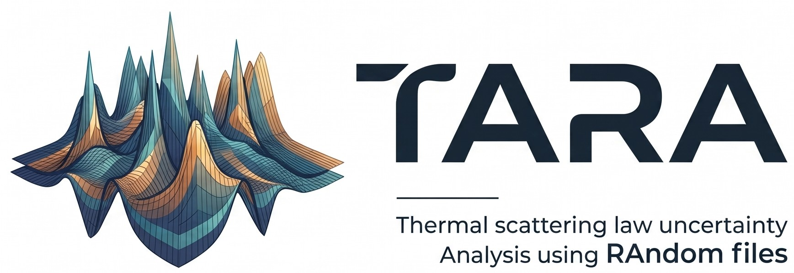

<div align="center">
  
</div>

# TARA: Thermal Scattering Law Uncertainty Analysis

[](https://opensource.org/licenses/MIT)
[](https://www.python.org/)

**TARA** (Thermal scattering law uncertainty Analysis using RAndom files) is a robust computational framework developed for the uncertainty quantification (UQ) of thermal neutron scattering laws. 

Designed for the nuclear data and reactor physics community, TARA utilizes stochastic sampling to generate physically consistent randomized thermal scattering files. By applying mathematically rigorous perturbations to amplitude and peak positions, the code allows researchers to propagate continuous-energy thermal scattering uncertainties into downstream Monte Carlo or deterministic transport solvers.

📖 **[Access the official TARA Documentation here.](docs/index.md)**

---

## 🚀 Scientific Capabilities

Unlike standard data perturbation tools, TARA is built to strictly enforce the physical constraints of nuclear data:

* **Topologically Valid Sampling:** Employs oversampling and dynamic bounding to ensure all randomized files respect physical conservation laws.
* **B-Spline Amplitude Perturbation:** Introduces smooth, artifact-free amplitude variations without non-physical discontinuities.
* **Diffeomorphic Peak Shifting:** Utilizes diffeomorphic mapping with precise Jacobian corrections to continuously shift energy or momentum transfer peaks while conserving reaction probabilities and phase-space integrals.
* **Coupled & Uncoupled UQ:** Supports both independent parameter sampling and the introduction of synthetic correlations between amplitude cross-sections and peak positions.

---

## Requirements

- **Python 3.13 or newer** and pip.
- **Git and a C++ toolchain** to build the NCrystal Liquids plugin from its Git repository. On Linux, use a working C++ compiler and build tools. On Windows, install Visual Studio Build Tools with the **Desktop development with C++** workload and a Windows SDK. Run the installation from the **x64 Native Tools Command Prompt for VS** with your Python environment active.
- **NJOY** for ACE generation. Set `[execution].njoy_executable` in the workflow TOML to an executable name on your PATH or an absolute path. The ACE workflow uses NJOY for the ACE conversion even when NCrystal generates the scattering law.

The Python dependencies are declared in [`pyproject.toml`](pyproject.toml) and installed by pip.

| Dependency | Requirement |
| --- | --- |
| NumPy, pandas, SciPy, joblib | `numpy`, `pandas`, `scipy`, `joblib` |
| NCrystal | `ncrystal>=4.0` |
| NCrystal Liquids | [`ncrystal-plugin-Liquids` from GitHub](https://github.com/dddijulio/ncrystal-plugin-Liquids) |
| ENDF, numerical, and storage packages | `endf-parserpy`, `numba`, `scikit-learn`, `tables` |
| Tests | `pytest` via the optional `test` extra |

## Installation

From the TARA repository root, create a Python 3.13+ environment and activate it.

| Platform | Create and activate the environment |
| --- | --- |
| Linux | `python3.13 -m venv .venv`, then `source .venv/bin/activate` |
| Windows (Command Prompt) | `py -3.13 -m venv .venv`, then `.venv\Scripts\activate.bat` |

Install TARA and its dependencies from the repository root:

```bash
python -m pip install .
```

The standard installation builds Liquids from source. On Windows, use `where cl` and `where nmake` in the installation prompt if CMake reports either tool missing. After installation, run `nctool --plugins` to check that NCrystal lists `Liquids`.

If a workflow does not use the Liquids plugin, you can comment out its Git dependency under `[project].dependencies` in `pyproject.toml` before installing. Workflows that use NCrystal Liquids require the plugin at runtime.

## Quick start

Run TARA from Python, use a TOML configuration with the CLI, or pass sampling options directly on the command line.

**Run an ACE workflow from TOML.** Open the example configuration and set the input files, output directory, and NJOY executable for your environment. Paths in the configuration are relative to the TOML file.

```bash
python -m application.cli ace --config application/configs/ace_njoy_solid.toml --validate-only
python -m application.cli ace --config application/configs/ace_njoy_solid.toml
```

**Sample a LEAPR spectrum directly.** Replace `my_material.leapr` with your input file.

```bash
python -m application.cli my_material.leapr --shift-mev 1.0 --shift-pct 5.0 -n 3
```

See the [Application Integration Guide](application/APP_INTEGRATION_GUIDE.md) for the NJOY and NCrystal configuration examples.

## Tests

```bash
python -m pip install ".[test]"
python -m pytest -ra
```

Pytest reports which tests were skipped and why. Tests that run real NJOY or optional native integrations need the relevant executables, plugin, or inputs.

## Contributing

Open an issue to discuss a proposed change, then submit a pull request describing the approach and the tests that cover it.

## Extending the Framework (Developer Guides)

This framework is built on a strict domain-driven architecture. We isolate execution, file I/O, mathematical sampling, and application logic into distinct boundaries. 

If you want to add new features, file formats, or backends, **do not modify the core physics or sampling algorithms.** Instead, follow the strict protocols outlined in our integration guides. 

These guides are specifically written to act as **System Prompts for AI Assistants (like ChatGPT, Claude, or Gemini)**. You can copy the raw text of any guide, paste it into an LLM, and it will generate the perfectly formatted boilerplate code required for your addition.

*   **[Core Integration Guide](./core/CORE_INTEGRATION_GUIDE.md):** Read this if you are adding new data schemas (`PhononSpectra`), mathematical smoothers, or new topological sampling strategies to the TARA engine.
*   **[Input/Output Integration Guide](./input_output/IO_INTEGRATION_GUIDE.md):** Read this if you are adding support for a new third-party file format (e.g., VASP, GROMACS, custom JSON). 
*   **[Backend Integration Guide](./analyzer/BACKEND_INTEGRATION_GUIDE.md):** Read this if you are connecting a new nuclear data execution engine (e.g., FLASSH, FRENDY).
*   **[Application Integration Guide](./application/APP_INTEGRATION_GUIDE.md):** Read this if you are adding new commands, arguments, or features to the `cli.py` user interface.


---
## 🏛 Acknowledgments & Funding

This work was supported by the European Union Horizon Europe programme through the **APRENDE** project (Grant Agreement No. 101061262).

The TARA project and TARA code are being developed at the **Autorité de Sûreté Nucléaire et de Radioprotection (ASNR)** as part of Task 4.2 (Thermal Neutron Scattering) within the APRENDE consortium.

## 📄 License

This project is licensed under the MIT License.

---