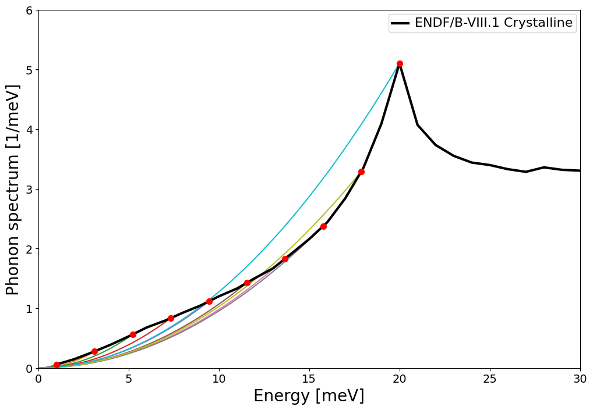

# Boundary Fixation: The Acoustic Anchor

In computational codes like [NCrystal](https://github.com/mctools/ncrystal), the low-energy boundary is not just an algorithmic cutoff parameter; it is a strict physical anchor representing the fundamental acoustic properties of the material.

## The Physics of the Connection Point

To understand the critical importance of this specific energy coordinate, we must look at how crystals behave at near-zero energies:

* **The Acoustic Limit:** At energies approaching absolute zero, phonon wavelengths are substantially larger than the interatomic spacing. In this long-wavelength limit, the discrete atomic lattice effectively behaves like a continuous elastic medium, allowing macroscopic sound waves (acoustic phonons) to propagate through the material.
* **The Quadratic Law:** Physics dictates that in this low-energy, non-dispersive regime, the Phonon Density of States (PDOS) always follows a predictable quadratic trajectory, $\rho(E) = k E^2$. This relationship is widely known as the Debye approximation.
* **Thermal Scattering Impact:** Thermal neutrons predominantly interact with these acoustic modes. The exact slope of this quadratic curve dictates the macroscopic speed of sound, aligns with the macroscopic specific heat capacity (following the Debye $T^3$ law), and directly governs the elastic and inelastic neutron scattering cross-sections at low momentum transfers.
* **The Physical Anchor:** The boundary point is the exact coordinate where this idealized acoustic behavior seamlessly merges into the complex, chaotic resonant peaks unique to the specific material. The $(x, y)$ position of this connection point permanently fixes the $k E^2$ term, securely anchoring the macroscopic density and acoustic properties of the structural model.

The figure below demonstrates how multiple candidate quadratic approximations are evaluated to seamlessly link the absolute zero point with the evaluated ENDF/B-VIII.1 Crystalline data.

*Figure 1: Quadratic Debye extrapolations bridging the (0,0) coordinate to the evaluated PDOS data. TARA freezes the final optimal connection point across all samples to guarantee physical continuity.*

## TARA’s Sampling Philosophy: A Frozen Boundary

To simulate uncertainty, TARA (Thermal scattering law uncertainty Analysis using RAndom files) perturbs the energy spectrum using a technique called **[Diffeomorphic Mapping](../sections/03_peak-position-sampling.md)**. You can visualize this by imagining the PDOS graph is printed on a perfectly elastic rubber sheet. TARA dynamically stretches and squeezes this rubber sheet to shift peaks and widen valleys. Because the mapping is diffeomorphic, it guarantees the transformation remains smooth (no tearing) and invertible (no overlapping or folding).

However, to safely stretch an elastic rubber sheet, **you must securely pin down its edges**. This is why TARA explicitly freezes the low-energy boundary point across all generated samples. This decision is not a software development shortcut; it is a strict physical necessity. If TARA allowed this boundary anchor to randomly shift or distort during the stretching process, it would fundamentally alter the $k E^2$ slope. Physically, this would simulate a material whose fundamental speed of sound and macroscopic density randomly changed from sample to sample, a physical impossibility that would cause catastrophic errors in cold neutron scattering evaluations.

By keeping this acoustic anchor frozen, TARA ensures that every randomized, warped variant maintains a structurally sound and physically valid low-energy limit.

---
[← Return to Sampling Methodology](../sections/01_sampling-methodology.md)