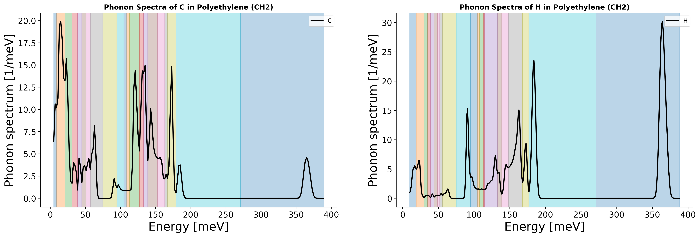
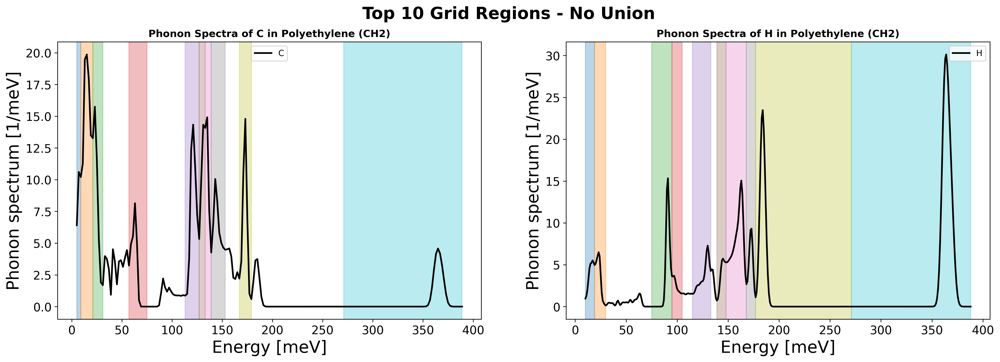
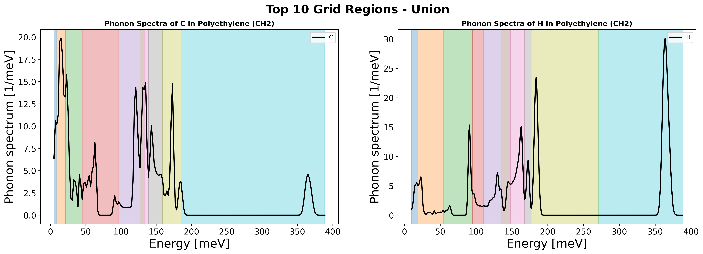

# Automatic Spectrum Splitting

When a user provides a global peak or amplitude shift without specifying the energy boundaries, TARA autonomously partitions the phonon spectrum to apply localized perturbations. Instead of applying a uniform shift across the entire spectrum, which can lead to physically unrealistic lattice dynamics, TARA dynamically identifies natural energy bands and isolates them into independent perturbation regions.

This page breaks down the mathematical methodology used to segment the phonon spectra into contiguous grid ranges, rank them by physical importance, and optionally merge them.

## 1. Valley Detection and Range Initialization

The first step in defining the grid is identifying the boundaries between distinct vibrational modes. TARA defines these boundaries by locating the local minima (valleys) in the PDOS.  Given a discretized phonon spectra as a function of energy, $\rho(E)$, TARA locates the set of valley energies $V_j$ by finding the local maxima of the inverted signal:

$$ V_j = \{ E_j \mid \rho(E_j) < \rho(E_{j-1}) \text{ and } \rho(E_j) < \rho(E_{j+1}) \} $$

To ensure the entire energy spectrum is covered, the absolute minimum energy $(E_{min})$ and absolute maximum energy $(E_{max})$ of the provided data are appended to $V$. The boundaries are then sorted chronologically, generating a set of $N$ contiguous energy ranges:

$$ R = \left\{ [E_0, E_1], [E_1, E_2], \dots, [E_{N-1}, E_N] \right\} $$

where $E_0 = E_{min}$ and $E_N = E_{max}$.

*Figure 1: The nominal grid generated by auto-detecting all valleys across the phonon spectra of Carbon and Hydrogen in Polyethylene.*

---

## 2. Importance Ranking via Integration

Not all detected peaks hold the same physical weight. A massive resonance peak represents many more vibrational states than a tiny fluctuation. To determine which energy ranges are critical for the perturbation grid, TARA evaluates the area under the curve for each range. First, the cumulative integral of the entire PDOS is calculated using the cumulative trapezoidal rule:

$$ I(E) = \int_{E_{min}}^{E} \rho(x) \, dx $$

The physical importance (weight), $W_i$, of any specific range $[E_{start}, E_{end}]$ is simply the definite integral enclosed by its boundaries:

$$ W_i = I(E_{end}) - I(E_{start}) $$

The initial ranges are sorted descendingly based on $W_i$.

---

## 3. Top-K Selection (No Union)

When users wish to restrict the perturbation grid to only the most dominant vibrational modes, they can request the top $K$ ranges. By taking only the $K$ ranges with the largest $W_i$, small noise artifacts and minor peaks are ignored. Applying this restriction inherently creates "gaps" in the energy spectrum where no perturbations are assigned.

*Figure 2: Selection of the top 10 regions by integral area. Notice the unshaded gaps where low-importance regions were dropped.*

---

## 4. Gap Bridging (Union)

If the union constraint (`combine_ranges=True`) is enabled, TARA stretches the remaining top $K$ ranges to fill the unassigned gaps seamlessly, ensuring continuous sampling across the energy spectrum. To do this without artificially skewing the energy boundaries toward an empty region, TARA does not simply take the geometric midpoint of the gap. Instead, it finds the **integral median**. 

If there is a gap between an active range ending at $E_{end, 1}$ and the next active range starting at $E_{start, 2}$, TARA calculates the target median integral:

$$ I_{target} = \frac{I(E_{end, 1}) + I(E_{start, 2})}{2} $$

TARA then locates the precise energy value $E_{mid}$ within the gap where $I(E_{mid}) \approx I_{target}$. The boundaries are then updated such that the first range ends at $E_{mid}$ and the second range begins at $E_{mid}$. This ensures the "dead space" is evenly divided based on the actual density of states present in the gap.

*Figure 3: The same top 10 regions from Figure 2, but expanded to bridge the gaps using the integral median, leaving no unperturbed energies.*

---
[← Return to Sampling Methodology](../sections/01_sampling-methodology.md)