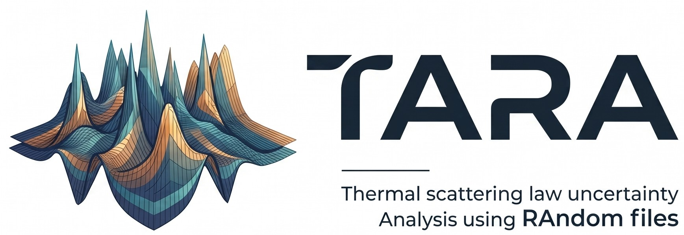
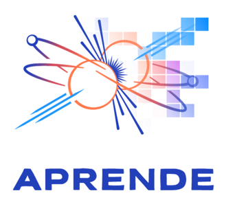

# Welcome to TARA Documentation

<div align="center">
  
</div>

**TARA** (Thermal scattering law uncertainty Analysis using RAndom files) is a robust computational framework developed for the uncertainty quantification (UQ) of thermal neutron scattering laws. 

Designed for the nuclear data and reactor physics community, TARA utilizes stochastic sampling to generate physically consistent randomized thermal scattering files. This documentation details the mathematical and topological methodologies used to apply rigorous perturbations to amplitude and peak positions, allowing researchers to safely propagate uncertainties into downstream transport solvers.

---

## Installation

From the TARA project directory, use Python 3.13 or newer and run `python -m pip install .`.
The default installation includes the NCrystal Liquids plugin. Pip fetches it from GitHub and builds it from source. [NCrystal plugin installation instructions](https://github.com/mctools/ncrystal/wiki/CuratedPlugins#liquids)

If the Liquids build fails because a C++ compiler is unavailable, choose the path that fits your workflow.

- **Install with Liquids.** On Windows, install the Visual Studio Build Tools with the **Desktop development with C++** workload. Open the **x64 Native Tools Command Prompt for VS**, activate your Python environment, and rerun `python -m pip install .`. On Linux, install a C++ toolchain through your distribution's package manager and rerun the command. [Microsoft C++ command-line build tools](https://learn.microsoft.com/en-us/cpp/build/building-on-the-command-line)
- **Install without Liquids.** If your workflow does not use the NCrystal Liquids plugin, comment out this entry under `[project].dependencies` in `pyproject.toml`, then rerun `python -m pip install .`.

  ```toml
  # "ncrystal-plugin-Liquids @ git+https://github.com/dddijulio/ncrystal-plugin-Liquids.git",
  ```

The [NCrystal Liquids workflow](sections/08_ncrystal-liquids-v2.md) requires the plugin at runtime. Run `nctool --plugins` in the same Python environment to check whether NCrystal lists `Liquids`.

---

## 📚 Table of Contents

* **[Background & Motivation](sections/00_background.md)**
  * The state of art of thermal scattering laws and the current data gap in nuclear libraries.
1. **[Sampling Methodology](sections/01_sampling-methodology.md)**
   * Oversampling techniques and Automatic Range detection.
2. **[Amplitude Sampling](sections/02_amplitude-sampling.md)**
   * Smooth, artifact-free perturbations using B-spline parametrization.
3. **[Peak Position Sampling](sections/03_peak-position-sampling.md)**
   * Continuous energy/momentum shifts via diffeomorphic mapping with precise Jacobian corrections.
4. **[Amplitude and Peak Shifting](sections/04_amplitude-peak-shifting.md)**
   * Independent sampling versus the introduction of synthetic correlations.
5. **[Configuration of Vibrational Spectrum Sampling](sections/05_user-configuration.md)**
   * Defining uncertainty bounds, dynamic grid partitioning, and correlation behavior.
### Liquid materials
6. **[Sampling translation in liquids](sections/06_translation-sampling.md)**
   * Describes the optional diffusivity and translation-weight controls.
---

## 🏛 Acknowledgments & Funding

This work was supported by the European Union Horizon Europe programme through the **APRENDE** project (Grant Agreement No. 101061262). 

<div align="center">
  
</div>

The TARA project and TARA code are being developed at the **Autorité de Sûreté Nucléaire et de Radioprotection (ASNR)** as part of Task 4.2 (Thermal Neutron Scattering) within the APRENDE consortium.

*Looking for the source code, installation instructions, or contribution guidelines? Return to the [TARA GitHub Repository](https://github.com/your-username/TARA).*

---