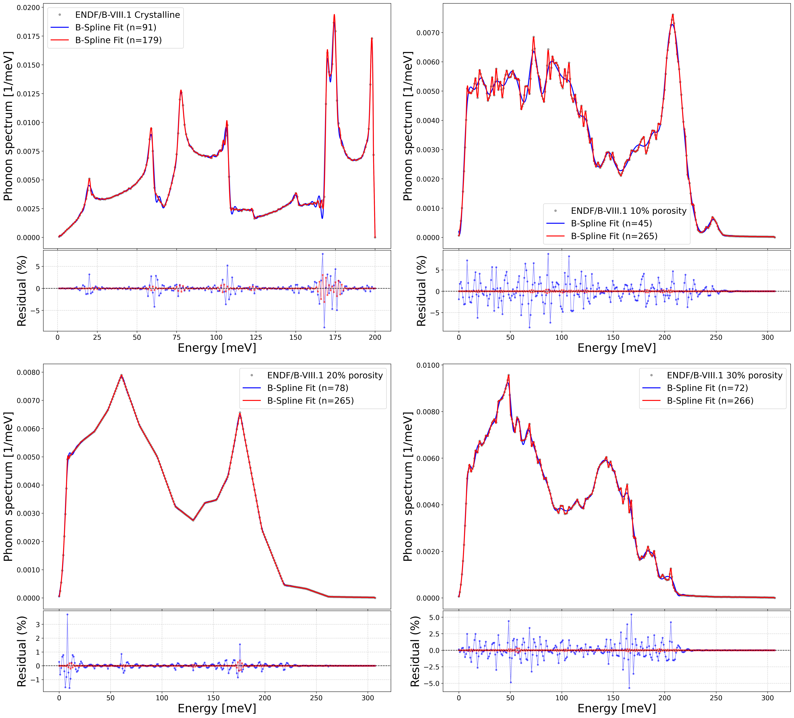
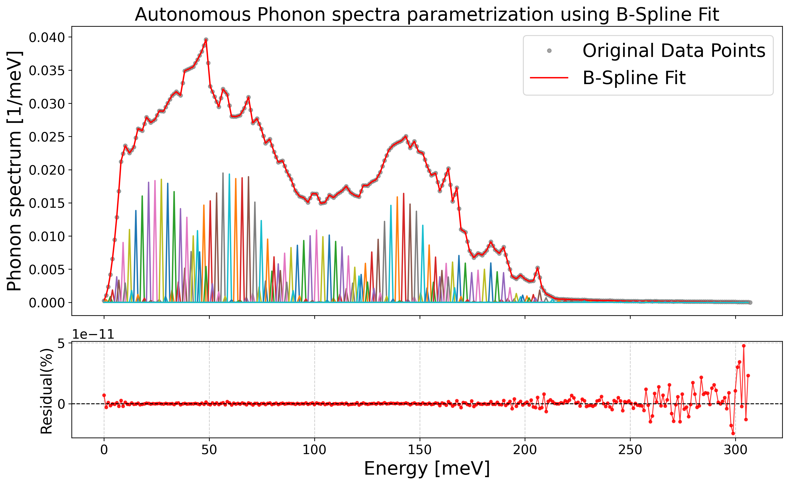
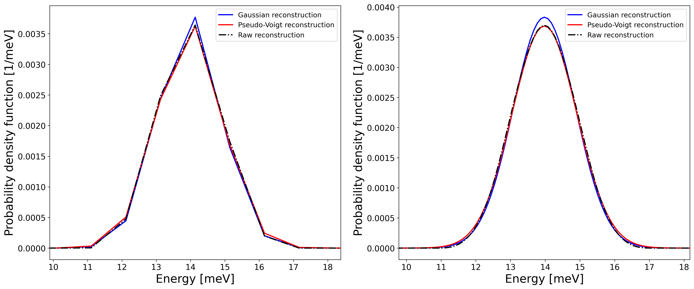

# 2. Amplitude Sampling: B-spline Parametrization

The ultimate objective of the amplitude sampling framework in TARA (Thermal scattering law uncertainty Analysis using RAndom files) is to provide a natural, physically robust method to perturb the amplitude of specific energy regions within the phonon spectrum. Before introducing statistical uncertainties, it is necessary to define a mathematical parametrization of the spectrum that can accommodate these local perturbations without violating fundamental physical constraints such as smoothness, positivity, and normalization.

## Parametrization of the Phonon Spectra

Previous uncertainty quantification schemes, such as those developed for estimating uncertainties in thermal scattering cross-sections of light water, implemented phonon spectrum parametrization using a sum of Gaussian functions. While this approach effectively captured the broad, well-separated vibrational bands characteristic of that specific liquid moderator, this representation becomes inadequate for structurally complex materials like nuclear graphite. Accurately resolving sharp, closely spaced lattice modes using Gaussian mixtures requires a massive number of components and careful tuning, significantly reducing robustness.

To address this, TARA utilizes a cubic B-spline curve, representing the underlying phonon spectrum, $\rho(\omega)$, as a linear combination of basis functions:

$$ \rho(\omega) = \sum_{i=0}^{n-1} c_i \cdot B_{i,3}(\omega_t) $$

### Physical Shape Preservation & The Central Limit Theorem

To understand the physical justification for using B-splines as a proxy for Gaussian distributions, we must look at the statistical nature of vibrational frequencies. In complex or disordered local environments, the exact vibrational frequency of any specific phonon mode is not perfectly fixed. Instead, it is continuously influenced by the sum of numerous independent, random environmental variables, such as the varying positions, distances, and orientations of neighboring atoms.

According to the Central Limit Theorem, when a large number of independent random variables are added together, their resulting distribution naturally converges toward a normal (Gaussian) distribution. Consequently, the macroscopic spectrum observed experimentally is simply the statistical average over this distribution. The peak of the distribution represents the mean energy of the vibrational mode, while the width serves as a quantitative measure of the inhomogeneous broadening caused by the variations in the local atomic environment.

The geometry of the B-spline basis functions, $B_{i,3}(\omega_t)$, is mathematically generated through the repeated convolution of uniform step functions. This recursive construction establishes a direct mathematical connection to this probability theory, allowing the B-spline to act as an optimal, localized proxy for a Gaussian kernel:

$$ B_{i,3}(\omega_t) \approx \frac{1}{\sigma^2\sqrt{2\pi}} \exp \left( - \frac{(\omega_t - \mu_i)^2}{2\sigma^2} \right) $$

Furthermore, because $\rho(\omega)$ is a normalized probability density function, it must remain strictly positive. While standard unconstrained least-squares fitting might mathematically propose negative coefficients to locally reduce residual errors, this violates the statistical foundation of the physical system. Therefore, the optimization algorithm in TARA strictly enforces a positivity constraint for every control point coefficient:

$$ c_i \ge 0 \quad \forall i $$

## Amplitude Sampling: The Mechanism of Perturbation

The core advantage of the B-spline parametrization becomes apparent when executing regional amplitude sampling. If a user wishes to isolate and perturb the amplitude of a specific energy region, a naive approach would involve applying a random scalar multiplier directly to the raw evaluated data points within those boundaries. However, doing so introduces severe, unphysical discontinuities. Because the numerical perturbation is applied as an abrupt step-function, this creates sharp, jagged "cliffs" exactly at the boundaries of the selected region, violating the continuous nature of the material's lattice dynamics.

The B-spline parametrization inherently solves this boundary-jump problem. Rather than manipulating the raw data grid, TARA applies the random sampling perturbations exclusively to the **control coefficients** ($c_i$) that govern the targeted energy domain. 

Because every physical coordinate on the resulting $\rho(\omega)$ curve is evaluated as a continuous linear combination of multiple overlapping basis functions, modifying a localized subset of control points smoothly diffuses the amplitude adjustment across the boundary. The inherent $C^2$ continuity (ensuring continuous slope and curvature) and the compact support of the B-spline guarantee that the borders of the sampled region adjust naturally to the perturbation. The mathematical overlap of the basis functions acts as a localized smoothing filter, ensuring that the target region smoothly and realistically merges with the unperturbed neighboring regions, completely eliminating extreme jumps or artificial cliffs.

## Verification of the Phonon Spectrum Parametrization

Nuclear graphite serves as a rigorous demonstration case due to the availability of four distinct structural evaluations in ENDF/B-VIII.1 (crystalline, 10%, 20%, and 30% porosity). These structural variations test the algorithm's robustness in capturing a wide range of complex spectral topologies.

*Figure 1: Comparison between ENDF/B-VIII.1 graphite phonon spectra (black) and their cubic B-spline reconstructions obtained with TARA (red/blue). The framework automatically adapts to diverse spectral topologies by adjusting the number of basis functions ($n$).*

### Automated Resolution and Convergence

The fidelity of the reconstruction relies heavily on finding the optimal number of basis functions ($n$). TARA automates this resolution scaling to ensure objective, high-fidelity fits without requiring manual user tuning. 

The algorithm iteratively evaluates the basis resolution, calculating the Mean Absolute Error (MAE) of the residuals at each step. By analyzing the differential between intervals (e.g., $k=1000$ vs $k=1100$), the fitting process automatically finds when convergence is reached and the MAE drops to negligible, near-zero levels (e.g., $4.73 \times 10^{-17}$). This strict convergence protocol guarantees a nearly perfect reconstruction of the raw data before any uncertainty sampling is applied.

*Figure 2: Autonomous parametrization of the phonon spectrum. The top panel displays the individual B-spline basis functions automatically generated to reconstruct the original data, while the bottom panel highlights the near-zero residuals achieved upon convergence.*

As the number of sub-intervals partitioning the domain increases, the reconstructed phonon spectrum stabilizes into a smooth, symmetric distribution. However, due to the finite spectral discretization and the strict positivity constraint ($c_i \ge 0$), the fully converged profile does not reduce to a pure theoretical Gaussian. Instead, numerical constraints restrict the local flexibility of the spline in the tail regions, resulting in a **pseudo-Voigt** profile. 

*Figure 3: Comparison of cubic B-spline–based phonon spectrum reconstructions illustrating the influence of basis resolution and positivity constraints. The emergence of a pseudo-Voigt profile represents a physically consistent compromise between resolution, numerical stability, and strict boundary enforcement.*

---
[← Return to Index](../index.md)