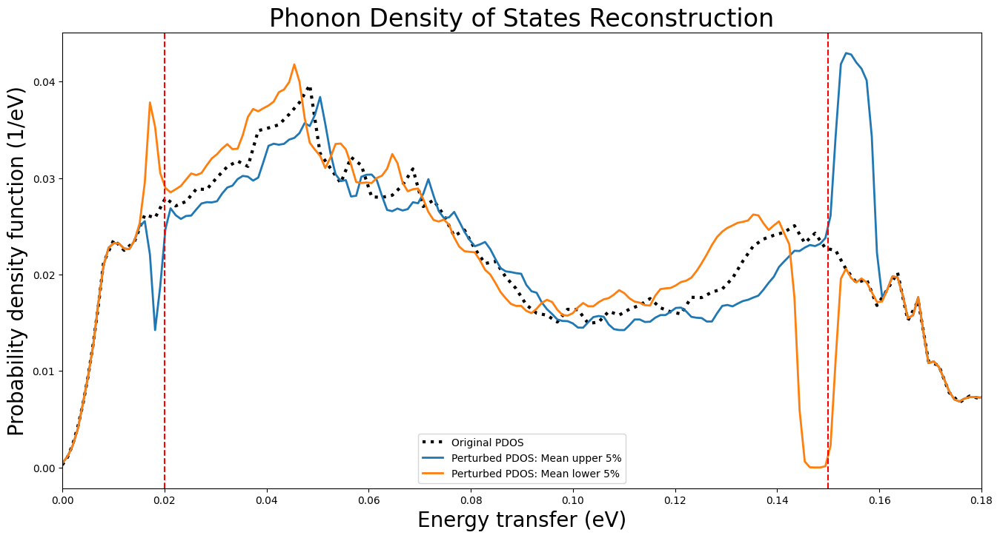
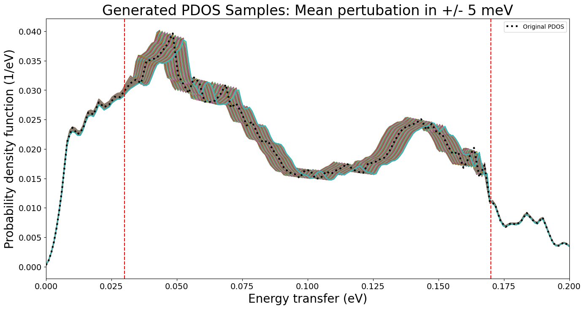

# 3. Peak Position Sampling: Diffeomorphic Mapping

Shifting peak positions within thermal scattering laws is a delicate procedure that requires strict adherence to physical constraints. The Phonon Density of States (PDOS) represents a normalized distribution of vibrational modes. Arbitrarily perturbing these energy states to quantify uncertainties can easily "tear" the data space, introduce unphysical discontinuities, or violate fundamental probability conservation laws. To ensure physical validity and structural continuity, TARA handles positional shifting using a diffeomorphic coordinate mapping combined with a Jacobian area correction.

## Smooth Boundary Decay: The Limitation of Standard B-Splines

When isolating a specific energy region for peak shifting, the applied spatial perturbation must seamlessly merge with the unperturbed adjacent spectrum. This physical constraint highlights the critical limitation of standard plane B-spline methodologies for *positional* shifting.

When a peak is moved within a bounded energy interval, the probability mass adjacent to the edges is altered. Shifting the curve creates an area differential at the boundaries between the original distribution and the newly shifted sample. The core challenge is generating perturbed samples that maintain the original, continuous appearance of the spectrum while successfully shifting the peak's position.

If a standard B-spline spatial transformation is applied, it often fails to account for this local area differential and does not intrinsically anchor the spatial displacement to zero at the endpoints. As shown in Figure 1, failing to respect these rigid boundary conditions introduces severe, non-physical discontinuities. Instead of smoothly transitioning back into the unperturbed data, this method creates abrupt, jagged "cliffs" exactly at the boundaries of the selected region.

*Figure 1: Phonon Density of States reconstruction using standard B-spline methodology. The spatial perturbation creates sharp, non-physical step-discontinuities at the region boundaries (red dashed lines).*

## Diffeomorphic Transformation: Coordinate Warping

To overcome these boundary limitations and safely move a peak, we must avoid shifting individual data points one by one. Moving points manually is mathematically risky because they can easily cross over each other. If one energy point passes another, the grid becomes tangled, resulting in broken, unphysical states that cannot be reversed.

Instead of moving the data points themselves, TARA applies a coordinate transformation directly to the underlying energy axis ($E \rightarrow E'$). **You can visualize this process as drawing the Phonon Density of States (PDOS) curve onto a perfectly elastic rubber sheet. To shift a peak, instead of erasing and redrawing the curve, TARA simply stretches or compresses the rubber sheet itself.** The data stretches smoothly along with the grid, inherently preventing any points from crossing.

To resolve the abrupt "cliffs" shown in Figure 1, TARA’s mapping function is explicitly forced to **decay smoothly to zero** at the edges of the selected region. By ensuring the stretching gradually fades out as it approaches the boundaries, the modified section blends seamlessly into the original, unperturbed background without any sharp breaks, maintaining what mathematicians call $C^k$ continuity.

However, just smoothing the edges is not enough, the way we stretch and compress the "rubber sheet" itself must also be mathematically verified. The transformation needs to be perfectly smooth and completely reversible. In mathematics, this kind of well-behaved transformation is known as a **diffeomorphic** mapping. For TARA's coordinate stretching to be considered diffeomorphic and physically valid, it must strictly follow two rules:

* **Smoothness ($C^\infty$ or $C^k$ Continuity):** The transformation function must be continuous and differentiable, ensuring no artificial singularities or step-discontinuities are introduced into the energy domain.
* **Invertibility (Strict Monotonicity):** The mapping derivative must be strictly positive (or strictly negative). This ensures the mapping does not "fold" back on itself. Energy states may be shifted, but their fundamental topological order is guaranteed to be preserved.

While this diffeomorphic stretching safely shifts the peak's position along the energy axis without breaking the grid, it introduces a new physical problem. The curve drawn on our "rubber sheet" represents a fixed total probability (the total number of vibrational states). If we stretch the sheet horizontally to move a peak, that section of the curve becomes wider, artificially increasing the area under the curve. In physics, we cannot simply create or destroy these states out of nowhere. Therefore, whenever we stretch or compress the energy grid (the width), we must simultaneously adjust the curve's amplitude (the height) to keep the total area perfectly constant.

## Probability Conservation and the Jacobian Correction

As we established, the phonon spectra behaves like a probability curve (specifically, a normalized Probability Density Function). A strict rule in physics is that the total area under this curve must stay exactly the same before and after the transformation.

If our mapping compresses a specific section of the energy grid, the probability mass in that region is squeezed into a much narrower band. Without an adjustment to the height of the curve, the total area shrinks, leading to an unphysical loss of probability. To automatically conserve this area, TARA applies a mathematical correction known as a change of variables, driven by a tool called the **Jacobian determinant**.

In our one-dimensional case, we are mapping the original energy axis ($E$) to the newly stretched or compressed energy axis ($E'$). The rule that preserves the probability mass between these two states is defined by the following differential relationship:

$$\rho_{new}(E') \cdot dE' = \rho_{old}(E) \cdot dE$$

Rearranging this equation yields the primary formula used by TARA to evaluate the perturbed amplitude:

$$\rho_{new}(E') = \frac{\rho_{old}(E)}{\left\vert{} \frac{dE'}{dE} \right\vert{}}$$

Where $\left\vert{} \frac{dE'}{dE} \right\vert{}$ represents the absolute value of the Jacobian determinant (the rate of stretching) at any given point. The Jacobian automatically adjusts the "height" (amplitude) of the curve to counteract the stretching or squeezing of the "width" (energy grid):

* **Local Compression:** If a section of the coordinate grid is squeezed together (meaning the stretching rate is less than 1), dividing by this fraction intrinsically scales the local amplitude upward. The curve becomes taller to preserve the probability mass.
* **Local Expansion:** Conversely, if the energy grid is stretched outward (meaning the stretching rate is greater than 1), dividing by a larger number naturally lowers the amplitude. The curve flattens out to ensure no extra area is artificially created.

*Figure 2: Generated PDOS samples using TARA's diffeomorphic mapping. The spatial shifts dynamically taper to zero at the region boundaries (red dashed lines), ensuring a seamless, physically valid transition with no artificial tearing.*

---
[← Return to Index](../index.md)