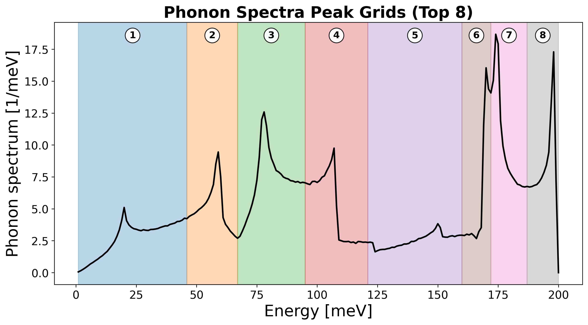
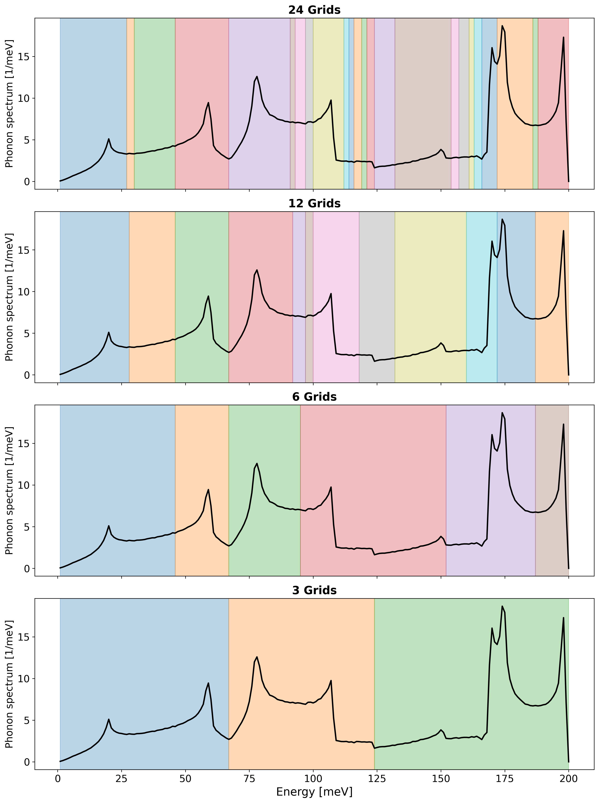
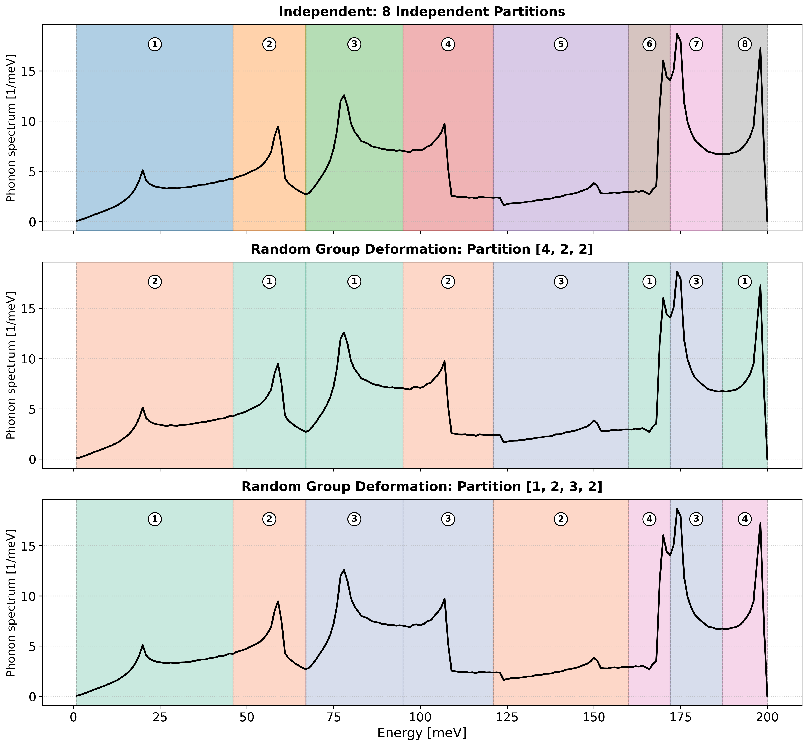

# 4. Amplitude and Peak Shifting

Thermal neutron behavior below a few eV plays a critical role in reactor physics for thermal-spectrum systems, where neutron moderation and thermalization strictly determine criticality, power density, and safety margins. The Thermal Scattering Law (TSL) dictates how neutrons scatter from bound atoms in moderator materials such as water, graphite, heavy water, polyethylene, and beryllium. Unlike higher-energy interactions where the free-gas approximation is sufficient, thermal neutron scattering must account for the chemical binding and crystal lattice effects that fundamentally alter scattering probabilities and angular distributions in the laboratory frame.

While modern evaluated nuclear data libraries have substantially expanded TSL coverage, with JEFF-4.0 containing approximately 80 evaluations and ENDF/B-VIII.1 containing roughly 110, a critical data gap persists. Currently, no publicly available library provides covariance matrices or formal uncertainty information for any TSL evaluation. This absence stands in stark contrast to conventional cross sections, creating significant limitations for rigorous safety analyses and reactor design optimization.

To perform realistic uncertainty quantification in the absence of established covariance data, stochastic sampling must comprehensively account for the inherent physical uncertainties within the underlying phonon spectrum. Because physical variations in crystalline and molecular structures rarely isolate a single spectral feature, robust uncertainty quantification requires the simultaneous perturbation of both the structural density (amplitude) and the energy state (peak position) of the vibrational modes. This section details how TARA combines B-spline amplitude sampling with diffeomorphic coordinate mapping to achieve this combined perturbation.

## 4.1 Independent Sampling

When operating under the assumption of independent sampling, TARA treats the mathematical operators for amplitude and spatial shifts as completely uncoupled random variables. To generate a randomized profile, the stochastic framework first executes the diffeomorphic coordinate transformation ($E \rightarrow E'$). This dynamic warping of the energy grid intrinsically applies the Jacobian determinant correction to preserve local probability mass. Subsequently, the algorithm projects this intermediate shifted spectrum onto the cubic B-spline basis, where independent random perturbations are applied strictly to the targeted control coefficients ($c_i$).

This decoupled approach is computationally efficient and mathematically appropriate when initial uncertainties can be treated as orthogonal. Furthermore, independent sampling serves as the default operational mode when perturbing evaluations from libraries that lack covariance information, relying primarily on the global constraints inherently imposed by integral normalization.

## 4.2 Structural Confinement and the Coherent Shifting Bias

Because current libraries provide no covariance information, TARA assumes that each peak in the spectrum (a localized region of non-zero probability) carries an associated error. Therefore, every randomized file generated by TARA is a systematic modification of the amplitude and position of the peaks found in the original spectrum. If the user does not explicitly define specific energy ranges for the perturbations, TARA automatically partitions the phonon spectrum. It identifies the natural domains of the data based on local minima and maxima to isolate distinct scattering peaks (as illustrated by the numbered regions 1 through 8 in Figure 3).

While this automated splitting successfully isolates distinct scattering features, it inherently introduces a structural confinement bias. To maintain physical continuity and prevent artificial tearing, the diffeomorphic mapping algorithm forces all spatial shifts to dynamically taper to zero exactly at the region boundaries. Consequently, once a natural domain is established, the enclosed peak can only shift within that rigidly bounded range (for instance, the dominant peak isolated in region 3 is mathematically confined and cannot shift its probability mass across the boundaries into regions 2 or 4).

*Figure 3: Automated partitioning of the crystalline graphite phonon spectrum into independent energy grids based on local minima and maxima. The numbered regions (1 through 8) and their rigid boundaries (vertical color transitions) isolate each peak, mathematically preventing a coherent, global spatial shift across multiple domains.*

In a structurally complex material characterized by multiple adjacent peaks, this boundary constraint prevents the entire spectral structure from shifting coherently together. By strictly locking the boundaries between contiguous domains (such as the fixed boundary separating region 6 from region 7), the independent methodology treats neighboring peaks as highly localized, isolated entities. This mathematical restriction fundamentally denies the possibility of a global, correlated lattice shift, such as a uniform translational shift applied to all 8 energy bands simultaneously. The immediate statistical consequence of this independent confinement is that, to adequately explore the phase space and account for all possible spatial shifting combinations across these isolated blocks, the total number of required stochastic samples must substantially increase.

## 4.3 Overcoming Confinement: Top-$K$ Selection and Domain Unioning

To resolve the structural confinement bias introduced by strict localized partitioning, TARA implements a Top-$K$ peak selection algorithm combined with intelligent domain unioning. Rather than forcing rigid boundaries around every minor local minimum (valley) across the entire spectrum, this approach allows the user to define the number of dominant scattering features ($K$) to dynamically isolate. 

TARA determines the physical importance of each natural domain by evaluating the cumulative integral of the phonon spectrum. The statistical weight ($W_i$) of any specific range is defined as the definite integral enclosed by its initial valley boundaries. By selecting only the top $K$ ranges containing the largest probability mass, minor structural artifacts and localized noise are bypassed.

Because extracting only the top $K$ ranges inherently creates unassigned gaps in the continuous energy grid, TARA applies a gap-bridging union constraint to restore a contiguous perturbation domain. To expand the active boundaries without artificially skewing the grid toward an empty energy region, the algorithm does not use the geometric midpoint. Instead, it calculates the target median integral of the gap and locates the precise **integral median** energy ($E_{mid}$) where this target is reached. The boundaries of the adjacent top-$K$ ranges are then stretched to meet exactly at $E_{mid}$, ensuring the unassigned probability mass is evenly divided based on the actual density of states present in the gap. *(For algorithmic details, see [Automatic Spectrum Splitting](../appendix/spectrum-splitting.md)).*

*Figure 4: The effect of Top-$K$ selection and domain unioning on the crystalline graphite phonon spectrum. Decreasing the number of isolated grids (from 24 down to 3) merges adjacent regions based on the integral median, removing rigid internal boundaries and allowing multiple enclosed sub-peaks to shift coherently within broad macro-domains.*

By encapsulating multiple minor peaks within a single, continuous top-$K$ domain, restrictive internal boundaries are systematically eliminated. As $K$ decreases, adjacent minor domains are smoothly merged into broader macro-domains. Consequently, the diffeomorphic transformation can apply a coherent, simultaneous spatial shift across the entire unified band. This macro-structural approach effectively mitigates the coherent shifting bias, enabling the mathematical simulation of global, correlated lattice perturbations (such as uniform structural expansion) while significantly reducing the dimensionality of the required stochastic sampling space.

## 4.4 Coherent Perturbation Limitation and Random Group Deformations

While Top-$K$ selection successfully merges adjacent domains to mitigate localized confinement, a fundamental statistical limitation persists across non-contiguous grids. The mathematical permutations available to divide the energy axis are finite, whereas the multidimensional parameter space governing peak shifts and amplitude variations is virtually infinite.

In extremely large stochastic ensembles, statistical probability allows independent domains to randomly receive identical perturbation vectors, naturally capturing a coherent physical shift. However, nuclear uncertainty quantification often requires highly restricted sample sizes to minimize the computational overhead of downstream continuous-energy transport calculations. In these small-sample regimes, the probability of capturing coherent, global correlations by pure statistical chance approaches zero.

To explicitly enforce correlated lattice perturbations across the entire spectrum without relying on massive sample ensembles, TARA implements a **Random Group Deformation** algorithm. This mechanism mathematically links disparate, non-contiguous spectral domains, ensuring they undergo strictly identical structural modifications.

The mechanics of this grouping algorithm are illustrated in Figure 5. Starting from a baseline of $N$ independent energy partitions (top panel), the group assignment proceeds dynamically prior to perturbation sampling:

1. **Integer Partitioning:** TARA first generates a randomized integer partition of $N$ to define the sizes of the coupled groups. For example, if a spectrum is divided into $N = 8$ distinct grids, the algorithm might divide the total count into three groups of sizes $[4, 2, 2]$ (Figure 5, middle panel) or four groups of sizes $[1, 2, 3, 2]$ (Figure 5, bottom panel).
2. **Domain Assignment:** The $N$ individual spectral ranges are subsequently distributed at random into these generated groups. As shown in the middle panel of Figure 5 for the $[4, 2, 2]$ partition, TARA assigns range indices $\{2, 3, 6, 8\}$ to Group 1, $\{1, 4\}$ to Group 2, and $\{5, 7\}$ to Group 3.
3. **Correlated Sampling:** During the uncertainty propagation phase, the stochastic engine generates a single set of perturbation parameters (peak spatial shift and B-spline amplitude scaling) per group, rather than per individual domain. All constituent ranges sharing a group identifier (and thus the same color in Figure 5) receive the exact same perturbation magnitude.

*Figure 5: Implementation of Random Group Deformations on the crystalline graphite phonon spectrum. The top panel shows the baseline configuration with 8 independent domains. The middle and bottom panels demonstrate random $[4, 2, 2]$ and $[1, 2, 3, 2]$ group partitions, respectively. Domains sharing the same group number and color are mathematically coupled to receive identical spatial and amplitude perturbations.*

By systematically coupling non-contiguous domains, this methodology guarantees the active presence of coherent, spectrum-wide shifts even within highly restricted sample sizes. Furthermore, because these grouped perturbations are still evaluated within the rigid, isolated boundaries of their original grids, the underlying diffeomorphic mapping ensures that even extreme lattice deformations remain physically constrained. This maintains structural continuity and generates unique, physically valid topologies without risking numerical tearing at the region boundaries.

---
[← Return to Index](../index.md)